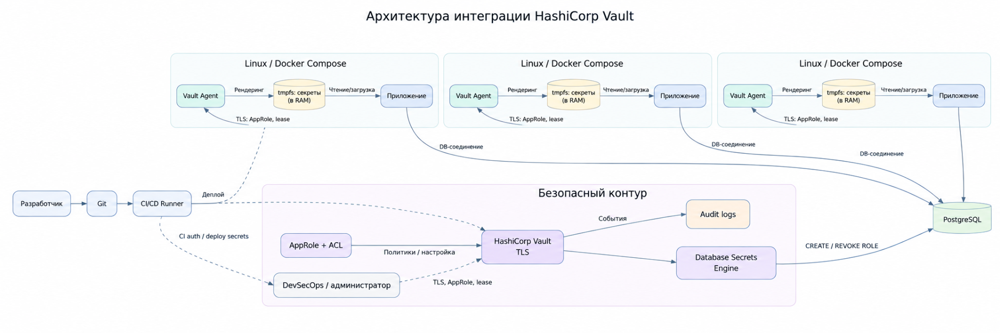

# Внедрение системы централизованного управления секретами на базе HashiCorp Vault

Учебный стенд по подключению приложений к Vault: AppRole → Vault Agent → файл с учётными данными в RAM → FastAPI → PostgreSQL. Присутствуют примеры ACL, динамических ролей PostgreSQL, аудита и GitHub Actions.

> **Статус:** учебная реализация / шаблон интеграции. Не является production-ready. Документация включает целевые возможности, которые ещё не реализованы. Даты Git-коммитов отражают фактическое время их создания, а не исторические периоды разработки.



## Запуск

Требуется Docker Engine / Docker Desktop с Linux-контейнерами, Docker Compose v2.

```bash
cp .env.example .env
# Установите уникальные значения локальных тестовых паролей в .env
docker compose up --build -d
# после перехода bootstrap в Exited (0):
curl http://localhost:8080/health
curl http://localhost:8080/db/check
```

`db/check` проверяет соединение с PostgreSQL через выданные Vault временные учётные данные; не раскрывает пароль. Для проверки API Vault в учебном контуре: `docker compose exec vault vault status`.

```bash
docker compose logs -f bootstrap vault-agent app
python -m pip install -r app/requirements-dev.txt
PYTHONPATH=app pytest -q app/tests
```

Остановка: `docker compose down`. Vault в `-dev` работает без сохранения состояния и при перезапуске выдаёт новые секреты; PostgreSQL сохраняется в Docker volume. Полное удаление тестовых данных: `docker compose down -v` (необратимо).

## Безопасность и ограничения

- `vault server -dev` и HTTP внутри контейнерной сети **исключительно для локального стенда**, без доступа в интернет. Нельзя использовать эту конфигурацию в production.
- Vault root token из `.env` известен локальному bootstrap-процессу; приложение его не получает.
- AppRole RoleID / SecretID создаются bootstrap и размещаются в локальном `runtime/`, который исключён из Git; необходимо защищать этот каталог на хосте. В production используйте доверенную доставку SecretID, например response wrapping.
- Сгенерированные креденшелы PostgreSQL рендерятся Vault Agent в общем tmpfs-томе (поддерживается Linux Docker Engine). Для чтения файла приложение использует непривилегированный UID и группу 0. Приложение считывает их при подключении. Доступ к файлу ограничен локальным runtime-процессом; разделение UID между контейнерами для production требует отдельной настройки.
- Для production необходимы TLS, приватная сеть, HA, KMS auto-unseal, backup/restore, мониторинг, проверка восстановления, безопасное хранение bootstrap credentials и реальная CI/CD-авторизация.

## Структура

- `app/` — FastAPI, динамический конфиг соединения, тесты.
- `infra/vault/` — AppRole, ACL, Agent, bootstrap.
- `docs/reference/` — предоставленные материалы (требования и примеры).
- `docs/` — состояние реализации, план по неделям, распределение ролей.
- `.github/workflows/` — статические проверки и unit-тесты; **без секретов для деплоя**.

Области ответственности: **DevOps** — Compose, сети, сборка и CI; **DevSecOps** — ACL, AppRole, ротация, аудит, проверки отказа доступа. Подробности: `docs/ROADMAP.md` и `docs/STATUS.md`.
